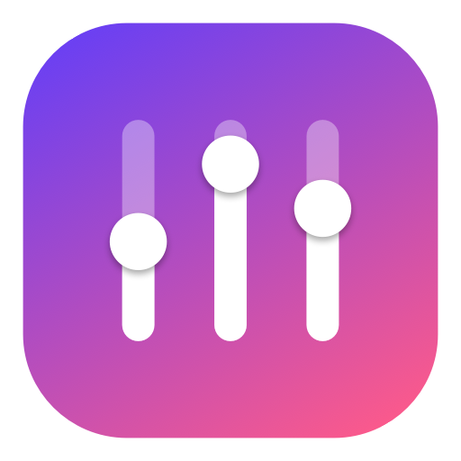
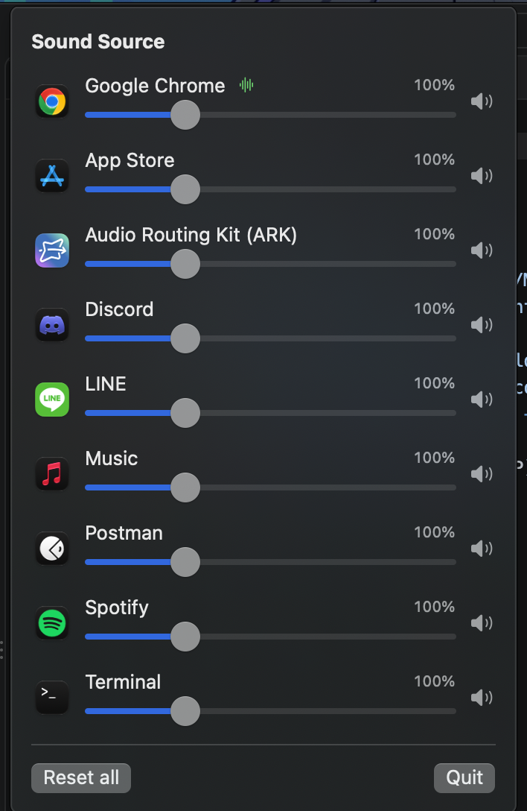

<p align="center">
  
</p>

<h1 align="center">mac-soundcontroller</h1>

<p align="center">
  A Windows-style <b>Volume Mixer</b> for macOS, living in your menu bar.<br>
  Per-app volume, mute, and boost up to <b>400%</b>. No audio driver required.
</p>

<p align="center">
  
  
  
  
</p>

<p align="center">
  
</p>

## Features

- **Per-app volume** — every app with an audio session gets its own slider
- **Boost to 400%** — make quiet apps louder, with a soft limiter to avoid harsh clipping
- **Mute per app** — one click, without touching the rest of your audio
- **Smart grouping** — helper processes (Chrome, Discord, ...) are merged under their parent app
- **Playing indicator** — apps currently producing sound float to the top with a green waveform
- **Non-invasive** — apps you haven't adjusted keep their normal system audio path, untouched
- **Remembers your settings** and follows you when you switch output devices
- **Lightweight** — native Swift/SwiftUI menu bar app, no Dock icon

## Install

1. Download `SoundSource.dmg` from the [Releases](../../releases) page
2. Open it and drag **SoundSource** into **Applications**
3. Launch it — a slider icon appears in the menu bar
4. On first use, allow **System Audio Recording** when macOS asks

> The app is ad-hoc signed (not notarized). If macOS refuses to open it, right-click the app and choose **Open**, or go to *System Settings → Privacy & Security → Open Anyway*.

## How it works

macOS 14.2 introduced **Core Audio process taps**. For each app you adjust, SoundSource:

1. Creates a tap on the app's audio processes, muting their original output
2. Wraps the tap and your current output device in a private aggregate device
3. Applies the gain (with a soft limiter above 0.9) inside the real-time IO callback
4. Plays the result to your speakers or headphones

Setting an app back to 100% removes the tap entirely.

## Build from source

Requires macOS 14.2+ and the Xcode Command Line Tools (full Xcode not needed).

```sh
git clone https://github.com/<your-username>/mac-soundcontroller.git
cd mac-soundcontroller
./make_dmg.sh        # builds build/SoundSource.app and build/SoundSource.dmg
open build/SoundSource.app
```

| Path | Purpose |
| --- | --- |
| `Sources/SoundSource/AppTap.swift` | Process tap, aggregate device, gain + limiter |
| `Sources/SoundSource/Mixer.swift` | App discovery, grouping, tap lifecycle |
| `Sources/SoundSource/SoundSourceApp.swift` | Menu bar UI |
| `tools/make_icon.swift` | Generates the app icon |

## Known limitations

- When an app spawns a new audio helper process while adjusted, the tap is rebuilt within ~2 s, which can cause a brief audio gap
- No EQ, per-app output device routing, or level meters yet

## Credits

Inspired by [FineTune](https://github.com/ronitsingh10/FineTune) and the approach described in [this write-up](https://dev.to/thalesbmc/macos-still-has-no-volume-mixer-so-i-built-one-53lp).

## License

Released under the [GNU General Public License v3.0](LICENSE).

---

### 🇹🇭 สรุปภาษาไทย

แอป menu bar สำหรับ macOS ที่คุมเสียงแยกรายแอปได้เหมือน Volume Mixer ของ Windows ปรับ volume, mute และ boost ได้สูงสุด 400% โดยไม่ต้องลง driver ใช้ได้กับ macOS 14.2 ขึ้นไป โหลด `SoundSource.dmg` จากหน้า Releases แล้วลากไปไว้ใน Applications ครั้งแรกให้อนุญาตสิทธิ์ System Audio Recording
